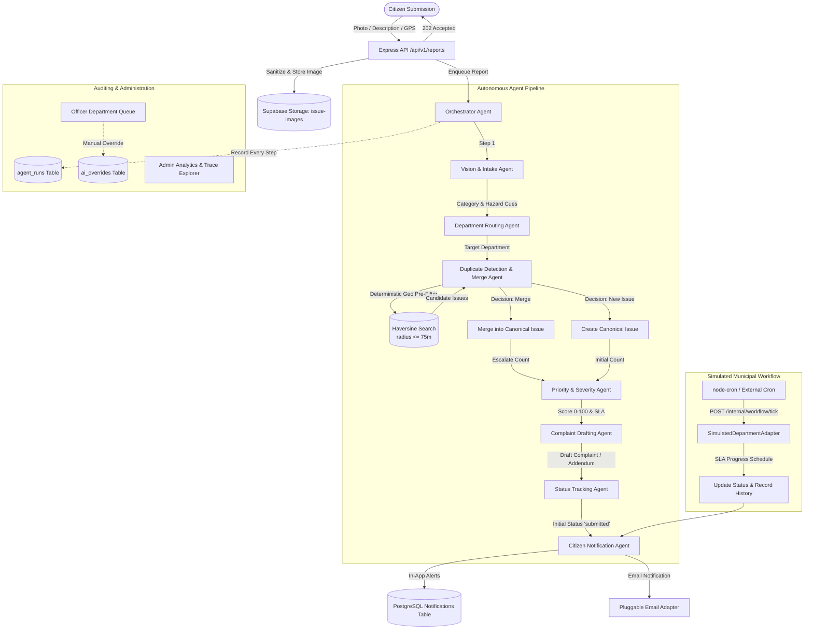

# CivicMind: Autonomous Agentic AI Civic Issue Coordinator

CivicMind is an autonomous, production-ready civic issue coordination platform. It replaces repetitive municipal decision-making, fragmented workflows, and departmental coordination delays with an intelligent pipeline of cooperating AI agents.

Citizens can snap a photo or type a single sentence. Autonomous agents plan, reason, classify, geolocate, deduplicate, prioritize, draft formal complaints, schedule simulated municipal workflows, and proactively update citizens with zero manual bureaucracy.

---

## Live Demo

- **Web Application**: [https://civicmind.vercel.app](https://civicmind.vercel.app) *(Replace with your Vercel deployment URL)*
- **API Health**: [https://civicmind-api.onrender.com/api/v1/health](https://civicmind-api.onrender.com/api/v1/health) *(Replace with your Render deployment URL)*
- **Video Walkthrough (4 Min)**: [https://youtu.be/civicmind-demo](https://youtu.be/civicmind-demo) *(Replace with your video link)*

---

## Architecture Overview



---

## Multi-Agent System Roles

| Agent | Role & Responsibility | Failure Fallback |
| :--- | :--- | :--- |
| **Orchestrator Agent** | Plans the 7-stage execution pipeline, manages shared context, handles retries, concurrency limits (max 3), and logs audit traces to `agent_runs`. | Deterministic sequential pipeline manager with stuck report recovery. |
| **Vision & Intake Agent** | Analyzes uploaded images (via `@google/genai` with magic-byte and EXIF sanitization) and citizen text. Extracts category, confidence score, visible details, scale, and hazard cues. | Regex and keyword classifier over citizen text with category baseline mappings. |
| **Department Routing Agent** | Dynamically queries active departments from database and routes the complaint based on category and physical evidence. | Direct foreign key lookup on department `handles_categories` or General Grievance Cell. |
| **Duplicate Detection & Merge Agent** | Executes geospatial pre-filtering (`haversine_m` within 75m and 30 days) and applies AI semantic matching to merge repeated reports into a single canonical issue. | Nearest candidate within 30 metres merges; candidates beyond 30m create new issue. |
| **Priority & Severity Agent** | Evaluates safety risk (0-40), public impact (0-20), location sensitivity (0-15), and weather/time risks (0-10). Backend adds corroboration bonus: `min(15, 3*(n-1))`. | Category severity baselines (road: 50, drainage: 50, water: 45, etc.) + corroboration bonus. |
| **Complaint Drafting Agent** | Formulates structured, official grievance documents including Subject, Salutation, Body, Location Block, Evidence Summary, Requested Action, and SLA timeline. | Standardized municipal grievance templates for full complaints and addenda. |
| **Status Tracking Agent** | Interfaces with municipal ERPs through `DepartmentAdapter`. Driven by `SimulatedDepartmentAdapter` advancing issues through SLA lifecycle fractions with `DEMO_TIME_SCALE`. | Local SLA-based deterministic progression timeline. |
| **Notification Agent** | Crafts empathetic, plain-language updates for all linked citizens informing them of merges, corroborations, and progress milestones. | Formatted system milestone messages personalized per recipient. |

---

## Authentication Architecture (Amendment A)

CivicMind implements a **stateless custom JWT + bcrypt authentication system**. Supabase is used **strictly as managed PostgreSQL and private Storage via the server's service role key**. The client application never connects to Supabase directly and contains zero Supabase libraries or keys.

- **Access Token**: Stateless HS256 JWT (15-minute TTL) containing `{ sub, role, departmentId }`, passed as an `Authorization: Bearer <token>` header in memory.
- **Refresh Token**: Cryptographically secure 64-byte random string, stored hashed (SHA-256) in the `refresh_tokens` database table, delivered via an `httpOnly; Secure; SameSite=None; Path=/api/v1/auth` cookie (7-day TTL).
- **Rotation**: Refresh tokens are rotated on every refresh and invalidated upon logout.
- **Deny-by-Default Middleware**: All authorization is strictly enforced in Express middleware (`authenticateToken`, `requireRole`). RLS is enabled on all PostgreSQL tables with zero public policies, preventing any direct anonymous database access.

---

## Quick Setup & Local Run

### 1. Prerequisites
- **Node.js**: v20 or higher (Tested on Node v26.13.1)
- **npm**: v10 or higher
- **Supabase Cloud Project**: Managed PostgreSQL and Storage

### 2. Installation
```bash
# In the repository root:
npm install --prefix server
npm install --prefix client
```

### 3. Environment Configuration
Copy `.env.example` templates:
```bash
# Server environment
cp server/.env.example server/.env

# Client environment
cp client/.env.example client/.env
```
Populate `server/.env` with your Supabase URL, Service Role Key, and Gemini API Key. Populate `client/.env` with `VITE_API_BASE_URL=http://localhost:4000/api/v1`.

### 4. Database Setup & Storage Initialization
```bash
# Verify database connection
npm run migrate --prefix server

# Ensure private Storage bucket exists
npm run setup:storage --prefix server

# Seed departments, demo users, and clustered demo issues
npm run seed:demo --prefix server
```

### 5. Start Development Servers
```bash
# Start backend API (Port 4000)
npm run dev --prefix server

# In another terminal, start client UI (Port 5173)
npm run dev --prefix client
```
Open your browser at **`http://localhost:5173`**.

---

## Default Demo Credentials

The database seeder automatically creates the following demo accounts with password **`DemoPassword123!`**:

| Role | Email | Password | Access / Purpose |
| :--- | :--- | :--- | :--- |
| **Citizen** | `citizen@demo.test` | `DemoPassword123!` | File reports, track live agent pipeline, view "My Reports", confirm "Still not fixed". |
| **Officer** | `officer@demo.test` | `DemoPassword123!` | Scoped to Roads & Public Works (RPW). Manage department queue, update statuses, override AI decisions. |
| **Admin** | `admin@demo.test` | `DemoPassword123!` | Full command center, analytics metrics, department CRUD, advance workflow trigger, agent trace explorer. |

*Tip: The Login page (`/login`) includes 1-click quick login buttons for all three roles.*

---

## Deployment Guide (Vercel + Render + Supabase)

### 1. Database & Storage: Supabase Cloud
1. Create a project at [supabase.com](https://supabase.com).
2. Open the **SQL Editor**, paste the contents of `supabase/migrations/001_initial_schema.sql`, and click **Run**.
3. Under Project Settings -> API, copy:
   - **Project URL**
   - **Service Role Key** (Keep secret! Used ONLY by Render backend).
4. Run `npm run setup:storage --prefix server` to verify the private `issue-images` bucket.

### 2. Backend API: Render Web Service
1. Create a new **Web Service** on [render.com](https://render.com) connected to this repository.
2. Settings:
   - **Runtime**: `Node 20`
   - **Root Directory**: `server`
   - **Build Command**: `npm install`
   - **Start Command**: `node src/index.js`
   - **Health Check Path**: `/api/v1/health`
3. Environment Variables:
   | Key | Value |
   |---|---|
   | `NODE_ENV` | `production` |
   | `PORT` | `10000` |
   | `CLIENT_ORIGIN` | `https://your-app.vercel.app` *(Exact Vercel URL, no trailing slash)* |
   | `SUPABASE_URL` | `https://your-project.supabase.co` |
   | `SUPABASE_SERVICE_ROLE_KEY` | *(Your Supabase service role key)* |
   | `SUPABASE_STORAGE_BUCKET` | `issue-images` |
   | `JWT_ACCESS_SECRET` | *(Random 32+ character string)* |
   | `JWT_REFRESH_SECRET` | *(Random 32+ character string)* |
   | `ACCESS_TOKEN_TTL` | `15m` |
   | `REFRESH_TOKEN_TTL_DAYS` | `7` |
   | `BCRYPT_COST` | `12` |
   | `COOKIE_SECURE` | `true` |
   | `DEMO_TIME_SCALE` | `1` (or `2000` for 43-second rapid demo lifecycle) |
   | `CRON_SECRET` | *(Random 24+ character secret)* |
   | `DEMO_PASSWORD` | `DemoPassword123!` |
   | `GEMINI_API_KEY` | *(Your Google Gemini API Key)* |
   | `GEMINI_MODEL` | `gemini-2.5-flash` |
4. Deploy the service and verify `/api/v1/health` returns `200 OK`.

### 3. Frontend Client: Vercel
1. Import this repository into [vercel.com](https://vercel.com).
2. Settings:
   - **Framework Preset**: `Vite`
   - **Root Directory**: `client`
   - **Build Command**: `npm run build`
   - **Output Directory**: `dist`
3. Environment Variables:
   | Key | Value |
   |---|---|
   | `VITE_API_BASE_URL` | `https://civicmind-api.onrender.com/api/v1` *(Your Render backend URL)* |
4. Deploy. `client/vercel.json` provides automatic SPA route rewrite (`/(.*)` -> `/index.html`).

### 4. Free-Tier Container Sleep Resilience
Render free-tier instances sleep after 15 minutes of inactivity:
1. **Lazy Reconciliation (`reconcileIssueStatus`)**: Any read of an issue automatically reconciles its status against the elapsed SLA timeline on first request after wake-up.
2. **External Pinger**: Setup a free monitor at [cron-job.org](https://cron-job.org) or [uptimerobot.com](https://uptimerobot.com):
   - **URL 1 (Keep-Alive)**: `GET https://your-backend.onrender.com/api/v1/health` every 10 minutes.
   - **URL 2 (Workflow Tick)**: `POST https://your-backend.onrender.com/api/v1/internal/workflow/tick` every 5 minutes with header `x-cron-secret: <CRON_SECRET>`.

---

## Post-Deployment Smoke Test Checklist

- [ ] **Health Check**: `GET /api/v1/health` returns `200 OK` with database status `healthy`.
- [ ] **Public Map**: Landing page loads and displays public issues from database.
- [ ] **Authentication**: Log in with `citizen@demo.test` / `DemoPassword123!`. Refresh token cookie is set with `HttpOnly; Secure; SameSite=None`.
- [ ] **Report Intake**: Submit a photo or text report. Observe live agent progress pipeline complete within ~15 seconds.
- [ ] **Duplicate Detection**: Submit a second report within 75m of the first. Verify automatic merge and priority score escalation.
- [ ] **Officer Access**: Log in as `officer@demo.test`. Review department queue and test an AI override.
- [ ] **Admin Command**: Log in as `admin@demo.test`. Click "Advance workflow now" button and confirm issues progress.
- [ ] **Token Refresh**: Wait 15 minutes or trigger an API call with expired access token; verify silent refresh without logout.

---

## Automated Test Suite

CivicMind includes 36 automated tests across backend and frontend:
```bash
# Run server test suite (33 tests)
npm test --prefix server

# Run client test suite (3 tests)
npm test --prefix client
```
Verified suites:
- Custom JWT and Bcrypt authentication (`auth.test.js`)
- Deny-by-default and RBAC middleware security (`auth.test.js`)
- Priority calculation and score bounds clamping (`scoring.test.js`)
- Finite state machine transition constraints (`statusMachine.test.js`)
- Geospatial Haversine calculation and distance thresholds (`duplicate.test.js`)
- Zod structured AI schemas and validation (`aiSchemas.test.js`)
- Client UI status badges and component rendering (`components.test.jsx`)

---

## License

This project is licensed under the MIT License. See [LICENSE](file:///LICENSE) for details.
