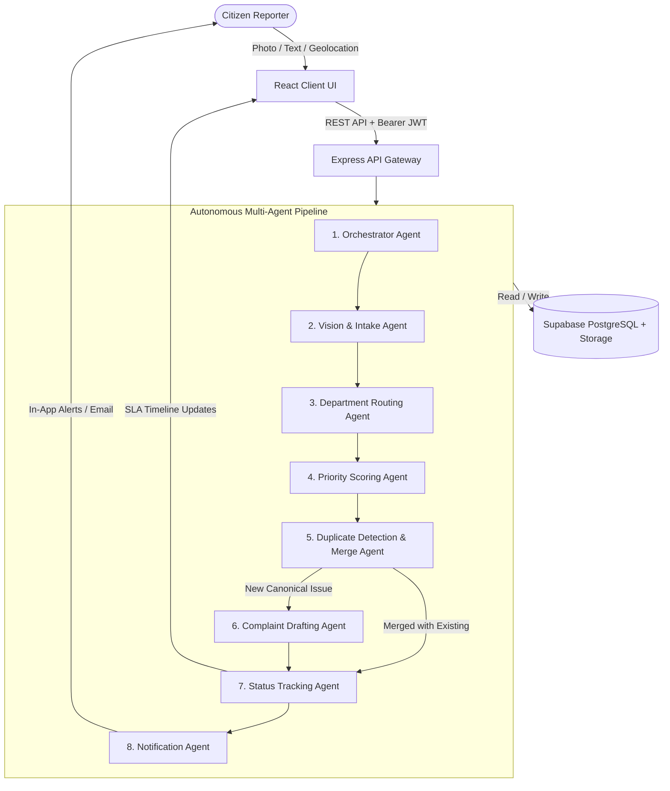
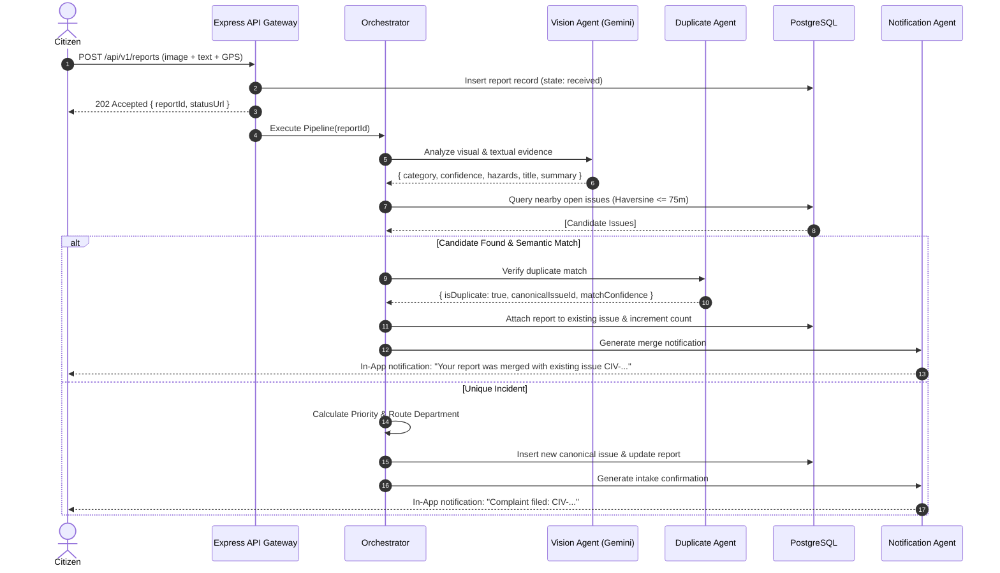

# CivicMind System Architecture & Solution Design

CivicMind is an autonomous civic issue coordinator powered by a multi-agent AI pipeline and a simulated municipal workflow engine. It transforms unorganized citizen submissions (raw photos and informal descriptions) into structured, prioritized, and trackable municipal complaints with zero human triage intervention.

---

## 1. System Architecture Overview

---

## 2. Multi-Agent System: 8 Autonomous Agents

CivicMind decouples civic problem resolution into eight focused agents operating sequentially or conditionally:

| Agent | Type | Core Responsibility |
|---|---|---|
| **1. Orchestrator Agent** | Deterministic Engine | Plans the execution pipeline, passes immutable shared context, manages retries, fallbacks, error isolation, and persists audit logs to `agent_runs`. |
| **2. Vision & Intake Agent** | Gemini 2.5 Flash Multimodal | Ingests uploaded imagery and raw text. Analyzes scene contents, classifies hazard category (`garbage`, `road_damage`, `streetlight`, `water_leakage`, `drainage`), and scores confidence. |
| **3. Department Routing Agent** | Hybrid (Rule + LLM) | Matches issue attributes against active municipal departments in the registry, selecting the primary department with explicit explainable justification. |
| **4. Priority Scoring Agent** | Hybrid (LLM + Formula) | Evaluates safety risk, public transit impact, location sensitivity (schools, hospitals, transit hubs), and weather hazards to produce an explainable priority score (0–100) and SLA tier. |
| **5. Duplicate Detection & Merge Agent** | Spatial Haversine + LLM | Pre-filters open issues within radius using PostgreSQL geospatial queries. Evaluates candidate similarity via Gemini. Merges repeat reports, links all reporters, and escalates priority. |
| **6. Complaint Drafting Agent** | Gemini 2.5 Flash Structured | Produces a formal municipal work order with reference numbering, formal subject line, structured description, geo coordinates, and SLA countdown. |
| **7. Status Tracking Agent** | Pluggable Adapter Engine | Tracks complaint lifecycle (`submitted` -> `triaged` -> `assigned` -> `in_progress` -> `resolved` -> `closed`). Features lazy reconciliation for container wakeups and demo time-scaling. |
| **8. Notification Agent** | Gemini 2.5 Flash Natural Language | Crafts concise, empathetic, non-technical updates for citizens whenever their report reaches a new milestone or is merged. |

---

## 3. Gemini AI vs. Deterministic Logic

CivicMind implements a principled hybrid design: **probabilistic AI handles perceptual ambiguity and unstructured human text, while deterministic algorithms enforce mathematical certainty, spatial accuracy, and security.**

| Pipeline Operation | AI (Gemini 2.5 Flash) | Deterministic Computation | Why this division? |
|---|---|---|---|
| **Image & Description Classification** | **Yes** (Multimodal LLM) | No | Visual comprehension of real-world civic hazards requires deep semantic vision. |
| **Spatial Radius & Geolocation** | No | **Yes** (Haversine formula in PostgreSQL) | Mathematical spatial distance calculations must be exact and fast. |
| **Duplicate Candidate Comparison** | **Yes** (Semantic judgment) | **Yes** (Geospatial & category pre-filter) | Eliminates expensive AI comparisons on distant reports; AI only compares true spatial neighbors. |
| **Priority Scoring (0–100)** | **Yes** (Visual severity factor estimation) | **Yes** (Capped weighted algebraic formula) | Mathematical weighting guarantees bounds and prevents arbitrary LLM hallucination. |
| **SLA Computation & Status Transitions** | No | **Yes** (Finite State Machine + Department SLA table) | Official SLAs and valid lifecycle transitions must strictly obey municipal policy. |
| **Complaint & Notification Phrasing** | **Yes** (Empathetic phrasing) | No | Plain-language human communication tailored to citizens requires nuanced text synthesis. |

---

## 4. End-to-End Execution Sequence

---

## 5. Technology Stack

- **Backend**: Node.js 20 LTS, Express, `@google/genai` SDK, Zod, Helmet, CORS, Pino, node-cron.
- **Frontend**: React 18, Vite, Tailwind CSS, Lucide Icons, TanStack Query, Leaflet / React-Leaflet, Axios.
- **Database & Storage**: PostgreSQL on Supabase Cloud, private S3-compatible Supabase Storage.
- **Authentication**: Custom stateless HS256 JWT access tokens (15m TTL) with cryptographically secure, hashed refresh tokens in httpOnly, SameSite=None cookies.
